# Sales History

[🏠 Home](README.md) · [💰 Sales History](sales.md) · [📦 Current Inventory](inventory.md)

---

## Build #22 · RTX 3070 / Intel i7-11700F
*October 2026*

**CPU** Intel i7-11700F · **GPU** RTX 3070 8GB · **RAM** 16GB DDR4-3200 · **Storage** HPE 960GB SATA III

**Cost:** $350 · **Sold:** — · **Profit:** —

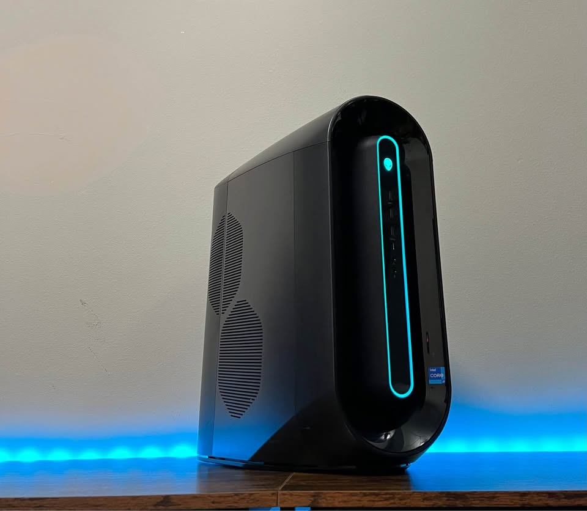

---

## Build #21 · RX 6800 XT / Ryzen 7 5800XT
*October 2026*

**CPU** Ryzen 7 5800XT · **GPU** Radeon RX 6800 XT 16GB · **RAM** 32GB DDR4-3200 · **Storage** 1TB Teamgroup Vulcan Z SATA SSD  
**Motherboard** ASRock B550M-C · **Cooling** Thermalright Aqua Elite 360 V6 · **PSU** EVGA SuperNOVA 650W G2 · **Case** Lian Li Vector V100

**Cost:** $809.45 · **Sold:** — · **Profit:** —

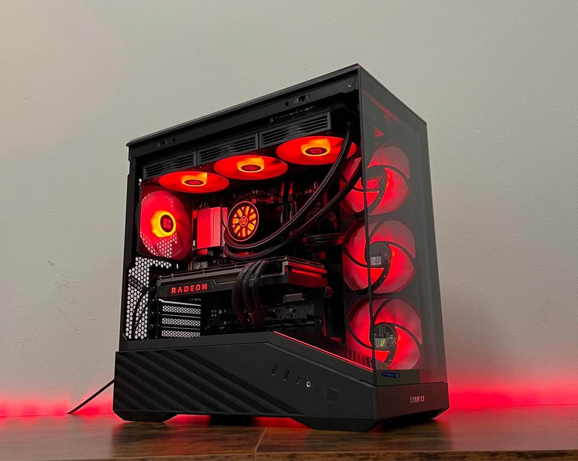

---

## Build #20 · RTX 2060 SUPER / Ryzen 7 3800X
*October 2026 · Facebook Marketplace*

**CPU** Ryzen 7 3800X · **GPU** MSI RTX 2060 SUPER Gaming X 8GB · **Motherboard** MSI X470 Gaming Plus Max  
**RAM** Corsair Vengeance RGB Pro 16GB · **Storage** 512GB NVMe SSD · **Cooler** Cooler Master Hyper 212 · **PSU** RAIDMAX Cobra 650W · **Case** EVGA DG-7

**Cost:** $340.70 · **Sold:** $450 · **Profit:** $109.30

The RAM turned out to be broken, so I replaced it for the buyer. The buyer was UW basketball player Harun Zrno.

**Lesson:** Stress-test systems more thoroughly.

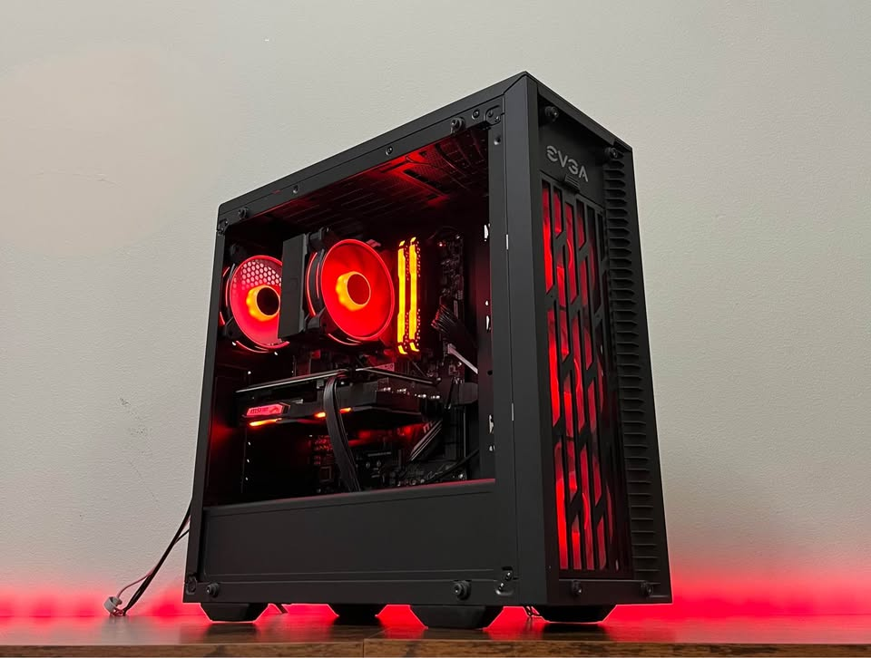

---

## Build #19 · RTX 4070 / Intel i7-13700F
*October 2026*

**CPU** i7-13700F · **GPU** RTX 4070 · **Motherboard** B660 · **RAM** 16GB DDR5-5600  
**Storage** 1TB M.2 NVMe SSD · **Cooler** Air cooler · **Case** MSI · **PSU** Highpower 650W

**Cost:** $850 · **Sold:** — · **Profit:** —

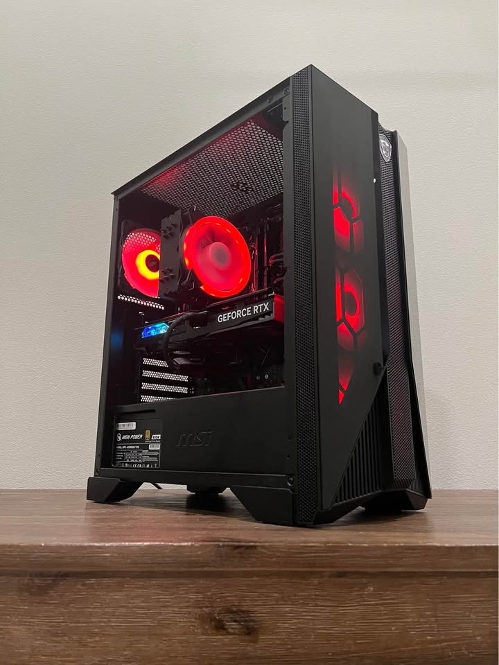

---

## Build #18 · GTX 1070 / Ryzen 5 2600
*October 2026 · Facebook Marketplace*

**CPU** Ryzen 5 2600 · **GPU** MSI GTX 1070 · **Motherboard** B450M Pro Max · **RAM** Trident Royal 16GB-2400  
**Storage** 512GB SATA SSD + 1TB HDD · **Cooler** AMD stock cooler · **Case** Cyberpower · **PSU** 650W

**Cost:** $248.96 · **Sold:** $400 · **Profit:** $151.04

A quick sale, despite the modest profit.  
**Lesson:** RGB aesthetics matter less when selling budget PCs.

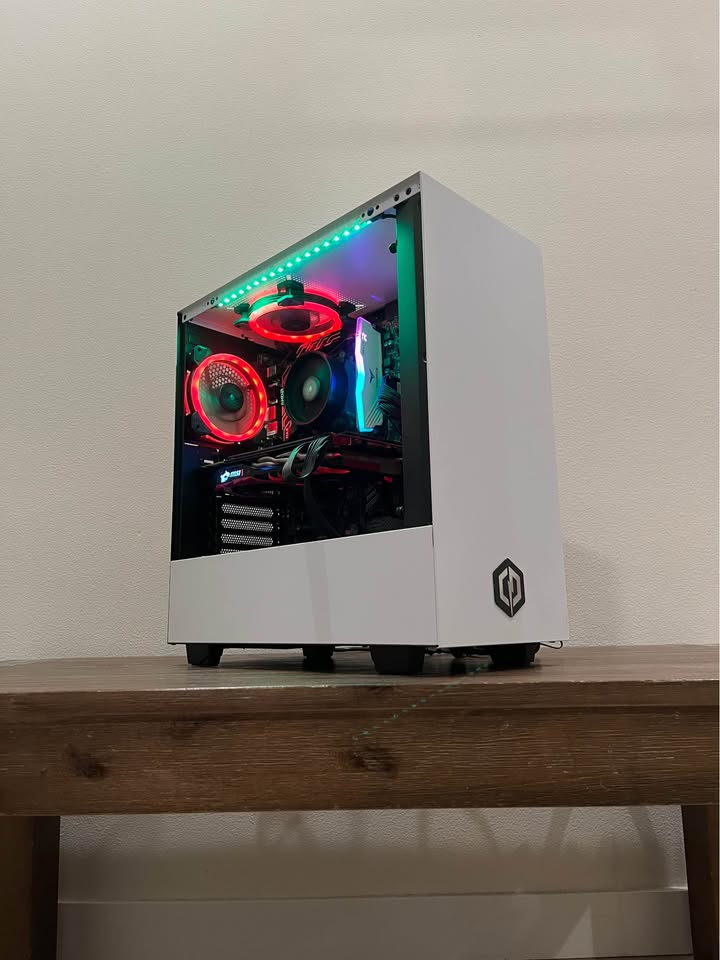

---

## Build #17 · RTX 5060 Ti / Ryzen 7 7700X
*September 2026 · Facebook Marketplace*

**CPU** Ryzen 7 7700X · **GPU** PNY RTX 5060 Ti 16GB · **Motherboard** MSI MAG B650 Tomahawk WiFi  
**RAM** 32GB G.Skill Ripjaws DDR5-6000 · **Storage** 1TB M.2 NVMe SSD · **Cooler** AIO with LCD screen  
**Case** White airflow case · **PSU** Seasonic 860W

**Cost:** $1,031.58 · **Sold:** $1,375 · **Profit:** $343.42

The buyer added 512GB of storage for $50. This was my strongest PC and biggest profit.  
**Lesson:** AI can help create listing descriptions.

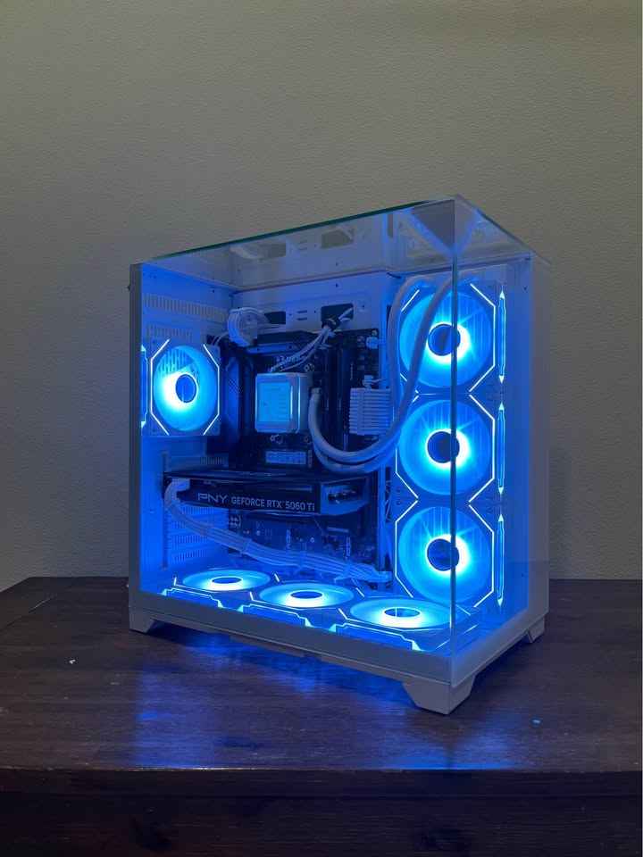

---

## Build #16 · RTX 3080 / Ryzen 7 5800X
*September 2026 · Facebook Marketplace*

**CPU** Ryzen 7 5800X · **GPU** Gigabyte RTX 3080 12GB · **Motherboard** B550M Pro VDH WiFi · **RAM** Trident Royal 16GB-3600  
**Storage** Samsung 512GB M.2 NVMe SSD · **Cooler** Corsair AIO · **Case** Cooler Master · **PSU** Corsair 850W

**Cost:** $638.48 · **Sold:** $875 · **Profit:** $236.52

This PC took a long time to sell.  
**Lesson:** Avoid unnecessary fans.

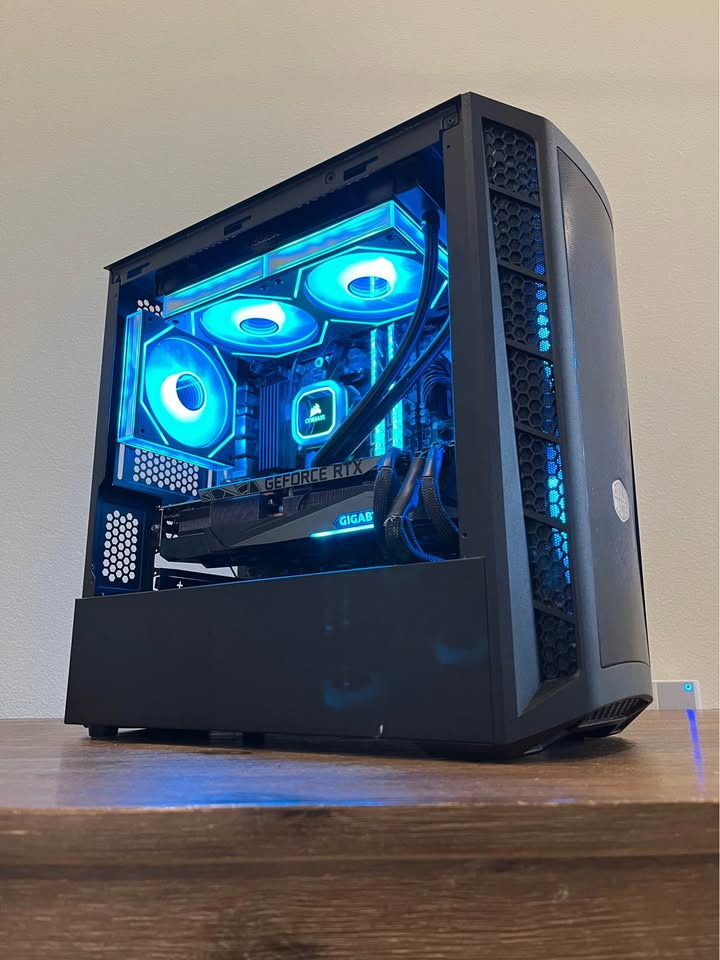

---

## Build #15 · RTX 2070 SUPER / Ryzen 5 5600X
*September 2026 · Facebook Marketplace*

**CPU** Ryzen 5 5600X · **GPU** Gigabyte RTX 2070 SUPER 8GB · **Motherboard** ASRock X570M Pro4  
**RAM** Corsair Vengeance RGB Pro 16GB-3200 · **Storage** 512GB M.2 NVMe SSD · **Cooler** Cooler Master Hyper 212  
**Case** NZXT S340 · **PSU** 750W 80+ Gold

**Cost:** $344 · **Sold:** $600 · **Profit:** $256

The original PC was advertised with an RTX 3070, but had an RTX 2070 SUPER, so I requested a partial refund.  
**Lesson:** Ask buyers for reviews.

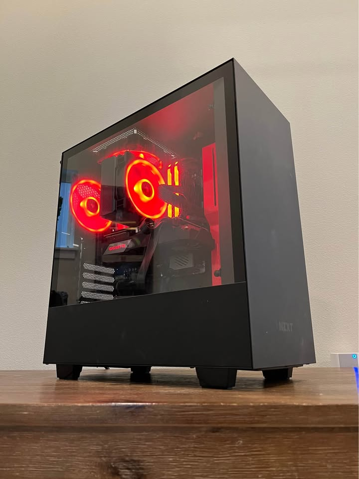

---

## Build #14 · RTX 2060 / Ryzen 7 3700X
*June 2026 · Facebook Marketplace*

**CPU** Ryzen 7 3700X · **GPU** RTX 2060 6GB · **Motherboard** ASUS PRIME B550-Plus · **RAM** Teamgroup 32GB DDR4-2666  
**Storage** 512GB M.2 NVMe SSD · **PSU** MSI MAG 500W · **Cooler** Air cooler · **Case** Phanteks

**Cost:** $291.70 · **Sold:** $500 · **Profit:** $208.30

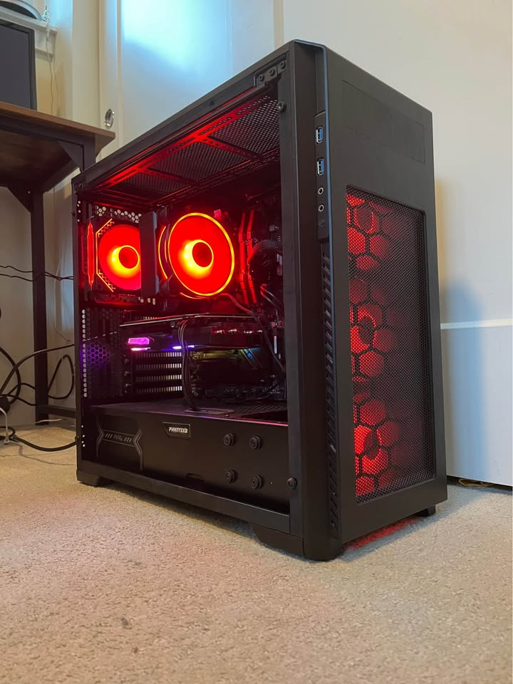

---

## Build #13 · RTX 2080 SUPER / Ryzen 7 3700X
*June 2026 · Facebook Marketplace*

**CPU** Ryzen 7 3700X · **GPU** RTX 2080 SUPER 8GB · **Motherboard** ASUS PRIME B550-Plus · **RAM** Corsair 16GB DDR4-3200 RGB  
**Storage** 512GB M.2 NVMe SSD · **PSU** RAIDMAX 650W · **Cooler** Air cooler · **Case** Sama Neview 4503

**Cost:** $489.70 · **Sold:** $650 · **Profit:** $160.30

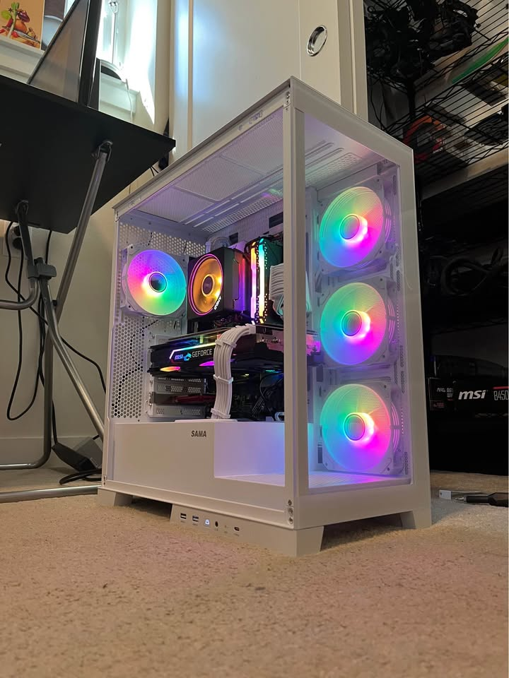

---

## Build #12 · RTX 3070 / Ryzen 5 5600G
*June 2026 · Facebook Marketplace*

**CPU** Ryzen 5 5600G · **GPU** RTX 3070 8GB · **Motherboard** MSI B450-A PRO MAX · **RAM** Corsair 16GB DDR4-3000 RGB  
**Storage** 512GB M.2 NVMe SSD · **PSU** RAIDMAX 650W · **Cooler** Air cooler · **Case** NZXT

**Cost:** $534.70 · **Sold:** $675 · **Profit:** $140.50

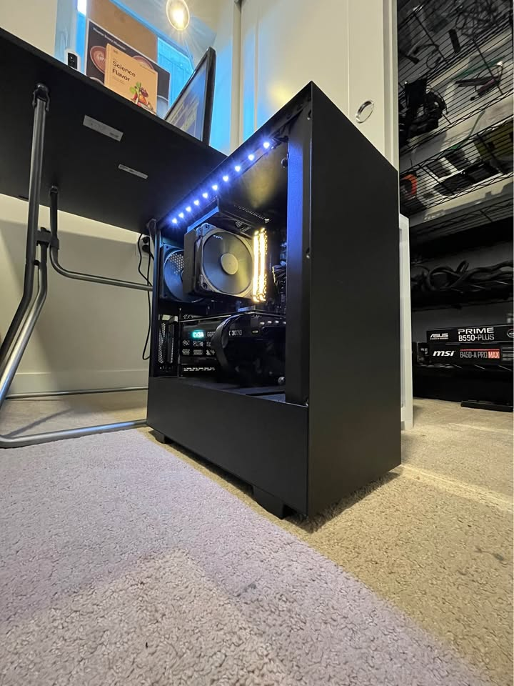

---

## Build #11 · RTX 3080 / Ryzen 9 3900X
*June 2026 · Facebook Marketplace*

**CPU** Ryzen 9 3900X · **GPU** RTX 3080 10GB · **Motherboard** MSI X470 Gaming Pro Carbon · **RAM** Corsair Vengeance 32GB-3200  
**Storage** 1TB M.2 NVMe SSD · **Cooler** Dual-tower air cooler · **Case** Lian Li O11 Dynamic Mini · **PSU** Cooler Master 850W SFX modular

**Sold:** $925 · **Profit:** $206

This was probably my best-looking PC. The case and PSU together cost $125, which was expensive for those parts. The profit made it worthwhile.  
**Lesson:** Avoid overspending on cases and PSUs.

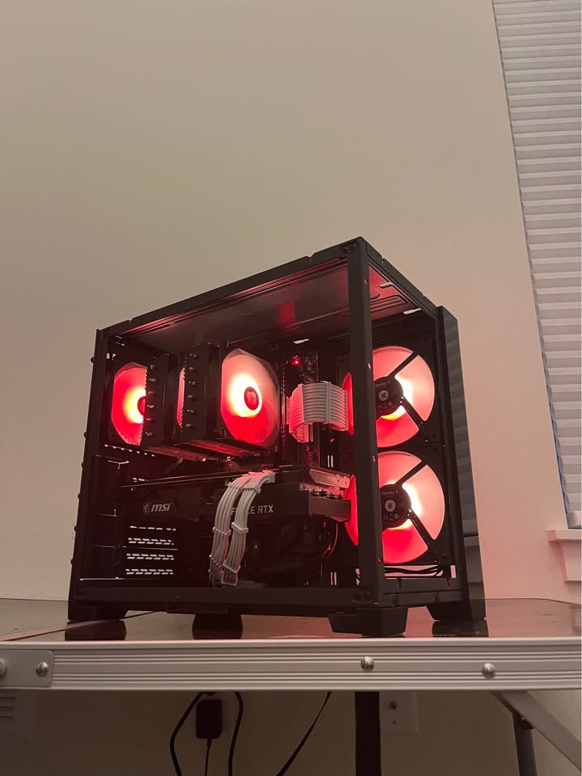

---

## Build #10 · RTX 2080 / Ryzen 7 3700X
*April 2026 · Facebook Marketplace*

**CPU** Ryzen 7 3700X · **GPU** RTX 2080 8GB · **Motherboard** ASRock B550 · **RAM** Teamgroup 16GB DDR4-3600  
**Storage** 1TB M.2 NVMe SSD · **Cooler** Air cooler · **Case** NZXT S340

**Cost:** $375.50 · **Sold:** $600 · **Profit:** $224.50

Built by upgrading another PC with an RTX 2080. The case was missing screws and a PSU bracket, which I replaced from my own inventory.  
**Lesson:** Recommend other parts you have to buyers.

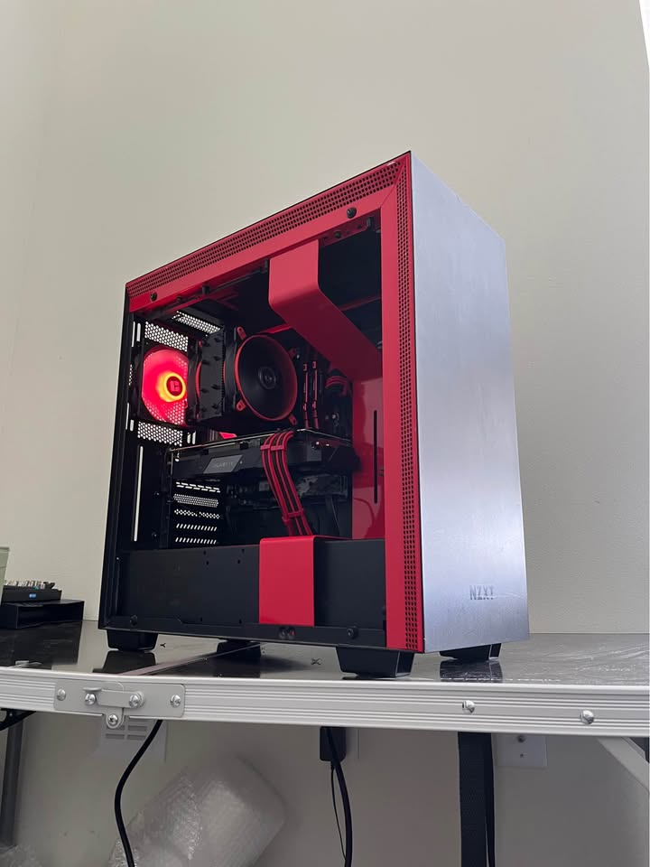

---

## Build #09 · RTX 3070 / Ryzen 5 5600
*April 2026 · Facebook Marketplace*

**CPU** Ryzen 5 5600 · **GPU** RTX 3070 8GB · **Motherboard** MSI B550 · **RAM** ADATA XPG 16GB DDR4-3000 RGB  
**Storage** 1TB SSD · **Cooler** AMD stock cooler

**Cost:** $465 · **Sold:** $725 · **Profit:** $260

Built using components from storage and parts bought at good prices.  
**Lesson:** Combining well-priced parts can lead to a strong profit.

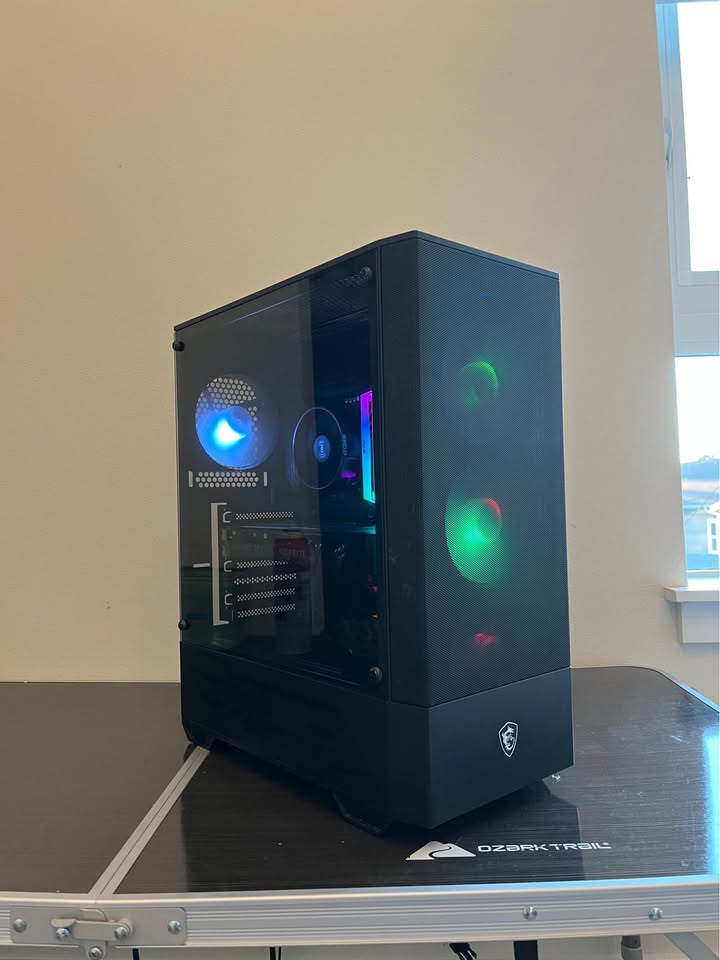

---

## Build #08 · RTX 3080 / Intel i7-12700F
*March 2026 · Facebook Marketplace*

**CPU** Intel Core i7-12700F · **GPU** RTX 3080 10GB · **Motherboard** Gigabyte B660 · **RAM** T-Force RGB 32GB DDR4-4000  
**Storage** 1TB M.2 NVMe SSD · **Cooler** Black air cooler

**Cost:** $728.50 · **Sold:** $850 · **Profit:** $121.50

Upgraded another PC by replacing its RTX 3070 with an RTX 3080, then used the RTX 3070 in another build.  
**Lesson:** Buy GPUs from reputable brands.

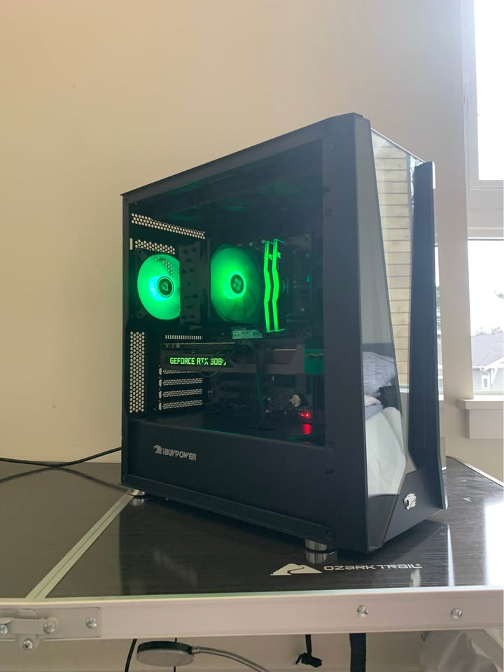

---

## Build #07 · RTX 3080 / Ryzen 7 5800X
*March 2026 · Facebook Marketplace*

**CPU** Ryzen 7 5800X · **GPU** RTX 3080 10GB · **Motherboard** B550 · **RAM** Corsair LED 16GB DDR4-3200  
**Storage** 512GB M.2 NVMe SSD + 512GB SATA SSD · **Cooler** Corsair RGB AIO

**Cost:** $668.50 · **Sold:** $900 · **Profit:** $231.50

Upgraded a PC with an RTX 3080 and Ryzen 7 5800X, moving its RTX 3070 into Build #06.  
**Lesson:** Swapping parts and reselling can be straightforward.

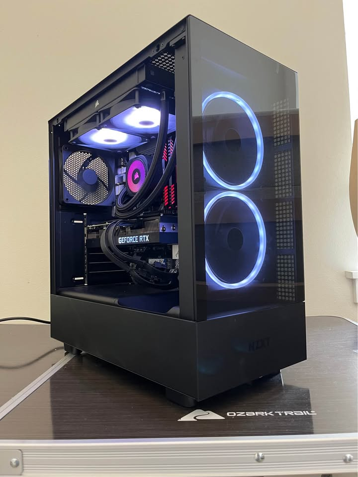

---

## Build #06 · RTX 3070 / Ryzen 5 5600X
*March 2026 · OfferUp*

**CPU** Ryzen 5 5600X · **GPU** EVGA RTX 3070 XC3 8GB · **Motherboard** ASUS B450M · **RAM** T-Force Vulcan Z 16GB DDR4-3000  
**Storage** 512GB M.2 NVMe SSD · **Cooler** Black air cooler · **PSU** Seasonic 750W Gold · **Case** Aura

**Cost:** $650 · **Sold:** $700 · **Profit:** $50

Originally bought a PC with an RTX 3080 and swapped in an RTX 3070 from another PC.  
**Lesson:** Swapping parts and reselling can be straightforward.

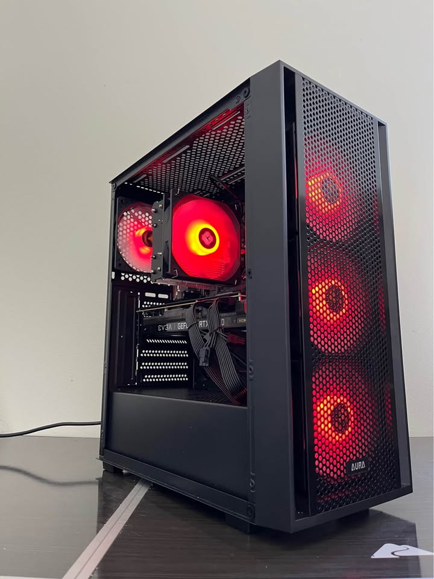

---

## Build #05 · RTX 3080 / Intel i7-10700K
*February 2026 · Facebook Marketplace*

**CPU** i7-10700K · **GPU** EVGA RTX 3080 FTW3 10GB · **Motherboard** ASUS Z590 · **RAM** Corsair RGB 16GB  
**Storage** 1TB M.2 NVMe SSD · **Cooler** Corsair AIO · **PSU** Corsair 850W · **Case** Corsair

**Cost:** $700 · **Sold:** $850 · **Profit:** $150

Bought at a good price on OfferUp, cleaned it, and relisted it without replacing any parts.  
**Lesson:** Sometimes you can simply clean and relist a PC.

---

## Build #04 · GTX 1060 / Ryzen 5 1500X
*February 2026 · Facebook Marketplace*

**CPU** Ryzen 5 1500X · **GPU** GTX 1060 · **Motherboard** ASUS B350M Gaming Pro · **RAM** 16GB DDR4-2400  
**Storage** 512GB Samsung SATA SSD · **Cooling** AIO · **PSU** Corsair CX750W · **Case** Zalman

**Cost:** $135 · **Sold:** $225 · **Profit:** $90

Bought mainly to downgrade parts and keep the better components for future builds.  
**Lessons:** OfferUp can be a source for PCs; downgrading parts before reselling can work well.

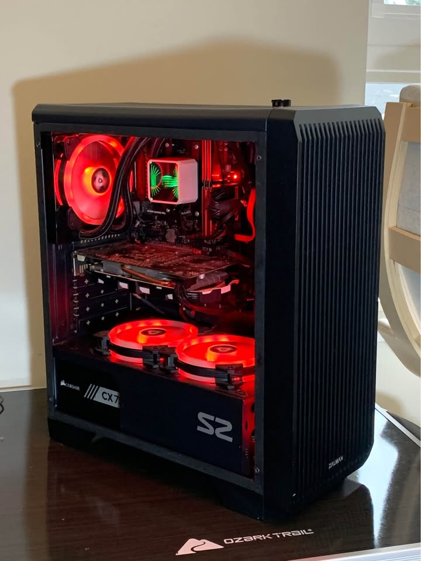

---

## Build #03 · RTX 2070 / Intel i7-8700
*February 2026 · Facebook Marketplace*

**CPU** Intel Core i7-8700 · **GPU** MSI RTX 2070 8GB · **RAM** 16GB DDR4-2400 · **Storage** 1TB Western Digital SATA SSD  
**Motherboard** ASUS B360M-A · **Cooler** AIO liquid cooler · **PSU** Thermaltake Smart 600W · **Case** SAMA SV02

**Cost:** $440 · **Sold:** $510 · **Profit:** $70

Bought a PC and upgraded its case before reselling. I also tried paying a friend to help.  
**Lessons:** You don't have to use every part from the original PC; hire help only for difficult jobs.

---

## Build #02 · RTX 3080 / Ryzen 7 5800X
*January 2026 · Jawa.gg*

**CPU** Ryzen 7 5800X · **GPU** Gigabyte Eagle RTX 3080 · **RAM** ADATA 32GB DDR4-3600 · **Storage** 1TB Inland Premium NVMe SSD  
**Motherboard** Gigabyte Vision D-P B550M · **Cooler** Thermalright Aqua Elite 360 V6 · **PSU** EVGA SuperNOVA 750W G+ · **Case** XPG Invader X ATX

**Sold:** $920 · **Profit:** $170

My first build upgraded from a prebuilt PC. I replaced its GTX 1080 with an RTX 3080.  
**Lessons:** Around $300 is a good price for an RTX 3080; buying and upgrading a whole PC can be easier than sourcing each part separately.

---

## Build #01 · GTX 1080 / Intel i5-10400
*September 2025 · Jawa.gg*

**CPU** Intel i5-10400 · **GPU** EVGA GeForce GTX 1080 · **Motherboard** MSI H510M-B · **RAM** Corsair Vengeance RGB Pro 16GB DDR4-3200  
**Storage** Patriot 1TB M.2 NVMe SSD · **PSU** EVGA BR 500W · **Case** DIYPC ARGB-G5-BK

**Cost:** $429 · **Sold:** $455 · **Profit:** $26

My first build. I sourced the parts separately and assembled them; it originally had an i3-10100F before I upgraded the CPU.  
**Lessons:** How to build a PC, find deals, and identify which parts appeal to buyers.

